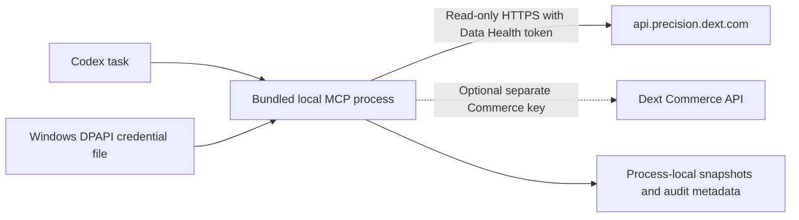

# Dext Codex Connector

[](https://github.com/bidule995/dext-codex-connector/actions/workflows/ci.yml)
[](https://github.com/bidule995/dext-codex-connector/actions/workflows/codeql.yml)
[](https://github.com/bidule995/dext-codex-connector/releases)
[](LICENSE)

An installable Codex plugin with a bundled, read-only MCP connector for Dext Data Health. You can add Dext Commerce invoice and bill reads with a separate Commerce API key.

> [!IMPORTANT]
> This independent, unofficial project has no affiliation with Dext. Do not paste Dext credentials into a Codex conversation. The connector does not reuse browser sessions, cookies, passwords, or two-factor codes.

## Release scope

`0.2.0-beta.1` runs on your computer as a Node.js 24 stdio process. It reads credentials from Windows DPAPI-protected storage or an explicit environment variable, then sends read-only HTTPS requests to the documented Dext host.

The plugin starts disabled when it cannot find a credential. An unconfigured install registers `connection_status` and `list_capabilities`; it makes no Dext request. A configured Data Health install adds:

- `search`, `fetch`
- `list_clients`, `get_client`, `get_client_activity_stats`
- `summarize_portfolio_health`, `find_client_health_risks`, `compare_clients`
- `snapshot_health_metrics`, `compare_health_snapshots`

Adding a separate Dext Commerce key also registers `list_invoices` and `get_invoice`. Dext Prepare invoices remain unavailable because Dext has not published a first-party Prepare API contract for this integration.

The connector registers no Dext write, export, delete, synchronization, account-connection, or file-extraction tools. Snapshots, audits, and record links stay in process memory and disappear when the plugin process stops.

## Install on Windows

You need Node.js 24, Git, Codex, and a dedicated Dext Data Health personal API token. Dext exposes token management under `Practice settings > Data Health > API tokens` for eligible accounts.

Clone the repository and run the protected setup helper. The prompt masks the token, Windows encrypts it for your current user, and the helper makes no Dext request.

```powershell
git clone https://github.com/bidule995/dext-codex-connector.git
Set-Location dext-codex-connector
.\scripts\configure-local.ps1
```

Install the plugin from its marketplace:

```powershell
codex plugin marketplace add bidule995/dext-codex-connector
codex plugin add dext-codex-connector@dext-codex-connector
```

Start a new Codex task and ask:

```text
Check my Dext connection status. Do not fetch client data yet.
```

Confirm that Data Health reports `mode: live`, `configured: true`, and `credentialSource: windows-dpapi`. You can then ask Codex to list clients. See [Local setup](docs/local-setup.md) for Commerce, non-Windows setup, verification, rotation, removal, and troubleshooting.

## Data and credential flow



MCP tools advertise `noauth` because Codex and the MCP child process run under the same local user. The upstream Dext API still requires its token. Tool results expose credential presence and source, never the credential value.

Read [Security and data handling](docs/security-and-data-handling.md) before using production client data.

## Development

Repository development requires Node.js 24 and pnpm 11.9.0:

```powershell
pnpm install --frozen-lockfile
pnpm check
python C:\Users\cesar\.codex\skills\.system\plugin-creator\scripts\validate_plugin.py .
```

Tests block external network access and use synthetic credentials, fictional payloads, in-memory MCP transports, loopback services, and an optional PostgreSQL database whose name must contain `test`. CI must not authenticate to Dext.

The Fastify, OAuth, PostgreSQL, and envelope-encryption source remains in the repository for a later hosted deployment. The local plugin bundle excludes those components. See [Hosted deployment](docs/hosted-deployment.md) for the deferred architecture.

## Upgrade and removal

```powershell
codex plugin marketplace upgrade dext-codex-connector
codex plugin remove dext-codex-connector@dext-codex-connector
codex plugin add dext-codex-connector@dext-codex-connector
```

Start a new task after reinstalling. Removing the plugin leaves the DPAPI-protected local credential in place so an upgrade or rollback does not destroy it. Use `scripts/remove-local-credentials.ps1` when you want to remove that local data, then revoke the token in Dext.

## Status

This project is beta software. Review tool arguments and returned client data before sharing outputs. Report security problems through [private vulnerability reporting](SECURITY.md).
